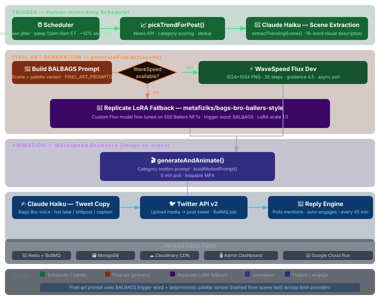

# Bags Bro! — Autonomous Content Engine



An autonomous social media content engine for the **Bags Bro!** NFT universe. The system runs continuously on Cloud Run, generating and publishing original pixel art posts to X/Twitter with no human input — trending topic reactions, hot takes, shitposts, and animated videos.

## What it does

1. **Trend detection** — polls News API and scores topics by category (crypto, hiphop, culture, markets, sports, tech)
2. **AI content generation** — Claude Haiku writes tweets, hot takes, and shitposts in the Bags Bro voice
3. **Pixel art generation pipeline**
   - Primary: **WaveSpeed Flux Dev** generates 1024×1024 pixel art from AI-composed `BALBAGS`-style prompts
   - Fallback: **Replicate** runs `metafiziks/bags-bro-ballers-style` — a Flux model fine-tuned on 500 Bags Bro! Ballers NFT images — when WaveSpeed is unavailable
4. **Animation** — static pixel art is handed to **WaveSpeed Seedance** (image-to-video) with category-matched motion prompts, producing loopable MP4 clips
5. **Intelligent scheduling** — a human-mimicking scheduler with Gaussian jitter, weighted post zones, sleep windows (midnight–8am ET), and a ~12% chance to skip a day entirely
6. **Publishing** — posts queued via BullMQ + Redis and uploaded to X/Twitter via the v2 API (image, GIF, MP4, or text-only)
7. **Reply engine** — monitors mentions and auto-engages with relevant replies every 45 minutes

## Tech stack

| Layer | Tech |
|---|---|
| Frontend | Next.js 14, TypeScript, Tailwind CSS |
| Backend | Fastify, TypeScript, Node.js 20 |
| Database | MongoDB |
| Queue | BullMQ + Redis |
| Pixel art (primary) | WaveSpeed Flux Dev |
| Pixel art (fallback) | Replicate — custom Flux LoRA (`metafiziks/bags-bro-ballers-style`) |
| Animation | WaveSpeed Seedance (image-to-video) |
| AI writing | Anthropic Claude Haiku |
| Social | X/Twitter API v2 |
| Media storage | Cloudinary |
| Infra | Google Cloud Run |

## Architecture

```
bagsbro-content-engine/
├── frontend/                        # Next.js promotional + admin site
│   └── src/
│       ├── app/
│       │   ├── page.tsx             # Landing page
│       │   ├── bagaverse/           # Bagaverse lore page
│       │   ├── admin/farmer/        # Content engine admin dashboard
│       │   └── api/farmer/          # Next.js API proxy routes
│       └── components/
│
└── backend/                         # Fastify API + autonomous engines
    └── src/
        ├── server.ts                # App entry point
        ├── services/farmer/
        │   ├── pixelArt.ts          # Image gen: WaveSpeed Flux → Replicate LoRA fallback
        │   ├── videoEngine.ts       # Animation: WaveSpeed Seedance image-to-video
        │   ├── postEngine.ts        # Content gen (Claude) + Twitter publish
        │   ├── trendingEngine.ts    # Trend detection + category scoring
        │   ├── contextEngine.ts     # Prompt builder per content type
        │   ├── queueEngine.ts       # BullMQ daily queue generation
        │   ├── scheduler.ts         # Human-mimicking timing loop
        │   ├── replyEngine.ts       # Mention monitoring + auto-reply
        │   └── twitterClient.ts     # Twitter API v2 client
        ├── jobs/                    # BullMQ queue definitions
        ├── api/                     # Fastify route handlers (auth + admin)
        ├── db/                      # MongoDB + Redis connections
        └── config/                  # Environment config + constants
```

## Key flows

### Autonomous post pipeline
```
Scheduler wakes at weighted zone (8am–midnight ET, ~1 skip/8 days)
  → pickTrendForPost()          — score + select trending topic by category
  → generatePixelArt(scene)
      → WaveSpeed Flux Dev      — primary: 1024×1024 PNG, BALBAGS style
      → Replicate LoRA          — fallback: metafiziks/bags-bro-ballers-style
  → generateAndAnimate()
      → WaveSpeed Seedance      — image-to-video, category motion prompt
  → publishPost()
      → Claude Haiku            — writes tweet copy in the Bags Bro voice
      → twitter-api-v2          — uploads media + posts tweet
  → BullMQ marks job done; reply engine checks mentions every 45 min
```

## LoRA training details

The fallback image model (`metafiziks/bags-bro-ballers-style`) is a Flux Dev LoRA trained on the full 500-token Bags Bro! Ballers NFT collection. The trigger token is `BALBAGS`. Training was run via Replicate's managed fine-tuning infrastructure with 35 inference steps and a LoRA scale of 1.0.

## Local development

### Prerequisites
- Node.js 20+
- MongoDB + Redis (or Docker)
- WaveSpeed API key
- Replicate API token
- Twitter Developer App with OAuth 1.0a keys
- Anthropic API key

### Backend

```bash
cd backend
cp .env.example .env        # fill in your values
npm install
npm run dev                  # starts on :8080
```

### Frontend

```bash
cd frontend
cp .env.example .env.local
npm install
npm run dev                  # starts on :3000
```

## Environment variables

See [`backend/.env.example`](backend/.env.example) and [`frontend/.env.example`](frontend/.env.example).

Key variables:
- `WAVESPEED_API_KEY` — pixel art + animation generation
- `REPLICATE_API_TOKEN` — fallback LoRA inference
- `ANTHROPIC_API_KEY` — tweet copy generation (Claude Haiku)
- `TWITTER_*` — X/Twitter API v2 OAuth keys
- `MONGODB_URI` — post history + media library
- `REDIS_URL` — BullMQ queue + session store
- `NEWSAPI_KEY` — trending topic detection
